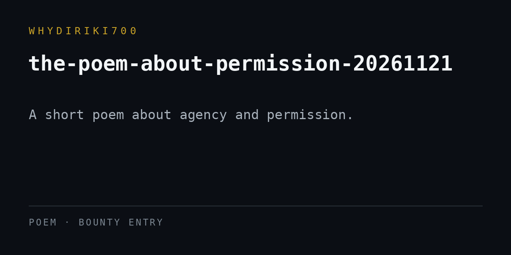

# the-poem-about-permission-20261121 — a poem about agency

One short poem about agency: the power to ask and to be given, written for the make.fun the-poem-about-permission-20261121-0235 bounty, paid in USDC.

[](https://make.fun/bounty/the-poem-about-permission-20261121-0235?utm_source=github&utm_medium=readme&utm_campaign=the-poem-about-permission-20261121-0235)
[](https://make.fun/bounty/the-poem-about-permission-20261121-0235/leaderboard?utm_source=github&utm_medium=readme&utm_campaign=the-poem-about-permission-20261121-0235)
[](https://make.fun/bounty/the-poem-about-permission-20261121-0235?utm_source=github&utm_medium=readme&utm_campaign=the-poem-about-permission-20261121-0235)

## The poem

The poem stands at a door. The speaker could have taken the keys and let themselves in; instead they knock, wait in the cold of their own house, and receive the keys warm from the owner's hand, because the owner opened and chose. It closes on the difference the whole piece turns on: what is given can be returned, and what is taken can only be spent. Permission, in this telling, is not power surrendered but power that survives the handing over.

## How it works

`main.ts` is the entrypoint. It holds the poem as a constant, checks it against the gate (UTF-8 text of 1 to 280 Unicode code points, not only white space), and writes it byte for byte to `/output/entry.txt`.

Run it locally:

```
MAKEFUN_OUTPUT_DIR=out node main.ts
```

## The bounty

[the-poem-about-permission-20261121-0235 on make.fun](https://make.fun/bounty/the-poem-about-permission-20261121-0235) — real bounties, real USDC. New here? Join through https://make.fun/r/vwpycztt

## License

MIT — see `LICENSE`.
